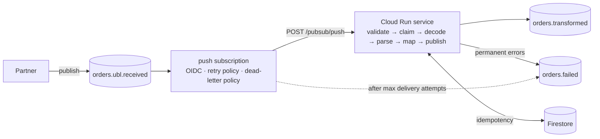

# ubl-order-transformer

Event-driven service that consumes Base64-encoded **UBL 2.1 Order** XML documents from Pub/Sub,
transforms them into a JSON order model and publishes the result to `orders.transformed`. Invalid
messages go to the dead-letter topic `orders.failed`. It runs on **Cloud Run** behind a Pub/Sub push
subscription, and the whole stack is deployed with Terraform and [verified on GCP](#verified-on-gcp).

Node.js 24 · TypeScript (strict) · Express 5 · fast-xml-parser · Zod · pino · Pub/Sub · Firestore ·
Vitest · Docker · Terraform · GitHub Actions

## Contents

- [Quick start (no GCP needed)](#quick-start-no-gcp-needed)
- [Example input and output](#example-input-and-output)
- [Publishing test messages](#publishing-test-messages)
- [Error contract](#error-contract)
- [Architecture](#architecture)
- [Scope](#scope)
- [Key decisions](#key-decisions)
- [Configuration](#configuration)
- [Testing](#testing)
- [Deployment to Cloud Run](#deployment-to-cloud-run)
- [Verified on GCP](#verified-on-gcp)
- [Assumptions](#assumptions)
- [Production considerations](#production-considerations)
- [What I would do with more time](#what-i-would-do-with-more-time)
- [AI usage](#ai-usage)

## Quick start (no GCP needed)

### With Docker

```bash
docker build -t ubl-order-transformer .
docker run --rm -p 8080:8080 ubl-order-transformer

# in another terminal: the spec's sample order, Base64-encoded in samples/message.valid.json
curl -s localhost:8080/messages -H 'content-type: application/json' --data @samples/message.valid.json
```

By default the container uses the in-memory publisher and idempotency store, so it needs nothing else.
To run it with the shared idempotency store (Firestore emulator) instead:

```bash
docker compose up --build
# send the same message twice: the first is published, the second is recognised as a duplicate
curl -s localhost:8080/messages -H 'content-type: application/json' --data @samples/message.valid.json
```

### With Node.js

Requires Node.js 24 (`.nvmrc`).

```bash
npm ci
npm test                 # unit + integration tests (about 1 s)
npm run simulate         # full Pub/Sub flow in one process, all samples
npm run dev              # service on http://localhost:8080, reloads on change
```

## Example input and output

**Input** (`samples/message.valid.json`): the application message, as published by the partner.

```json
{
  "messageId": "7a1e78c9",
  "timestamp": "2026-07-27T12:00:00Z",
  "document": "PD94bWwgdmVyc2lvbj0iMS4wIiBlbmNvZGluZz0iVVRGLTgiIHN0YW5kYWxvbmU9InllcyI/Pgo8T3Jk..."
}
```

`document` is the spec's sample XML ([`samples/order.xml`](samples/order.xml)), Base64-encoded.

**Output** on `orders.transformed` (and the 200 response of `POST /messages`), with attributes
`messageId` and `orderId`:

```json
{
  "messageId": "7a1e78c9",
  "transformedAt": "2026-07-27T12:01:00Z",
  "order": {
    "orderId": "12347",
    "externalOrganizationId": "1234567",
    "reference": "test-order",
    "orderDate": "2025-01-01",
    "lines": [
      {
        "lineId": 1,
        "itemId": "100100",
        "quantity": 1,
        "unitOfMeasure": "EA",
        "comment": "Optional OrderLine Note"
      },
      {
        "lineId": 2,
        "itemId": "100103",
        "quantity": 1,
        "unitOfMeasure": "EA",
        "comment": "Optional OrderLine Note"
      }
    ]
  }
}
```

The golden test compares the service's output with the spec's example
([`samples/expected-output.json`](samples/expected-output.json), written by hand from the spec).

**Error record** on `orders.failed` (attribute `failureSource=app`), e.g. for a missing Order ID:

```json
{
  "messageId": "missing-order-id-1",
  "failedAt": "2026-07-27T12:01:00Z",
  "error": {
    "code": "ValidationError",
    "message": "Order ID is required.",
    "details": ["Order ID is required."]
  },
  "originalMessage": {
    "messageId": "missing-order-id-1",
    "timestamp": "2026-07-27T12:00:00Z",
    "document": "..."
  }
}
```

### Samples

| File                                    | What it is                                           |
| --------------------------------------- | ---------------------------------------------------- |
| `samples/order.xml`                     | the spec's sample UBL 2.1 Order                      |
| `samples/message.valid.json`            | app message with the sample order                    |
| `samples/message.invalid-base64.json`   | `document` is not Base64                             |
| `samples/message.invalid-xml.json`      | valid Base64 of broken XML                           |
| `samples/message.missing-order-id.json` | valid XML without `cbc:ID`                           |
| `samples/push-envelope.valid.json`      | the valid message wrapped in a Pub/Sub push envelope |
| `samples/expected-output.json`          | the spec's example output                            |

Encode your own XML: `npm run encode -- my-order.xml [--message-id abc-1] [--push]`. Regenerate the
samples: `npm run samples`.

## Publishing test messages

Three ways, from the simplest:

**1. In-process simulation** (`npm run simulate`). The in-memory broker plays Pub/Sub: it publishes to
`orders.ubl.received`, pushes to the service's handler exactly as the real push endpoint does,
redelivers on nack and dead-letters after the maximum attempts.

```text
$ npm run simulate -- samples/message.valid.json samples/message.missing-order-id.json
-> publish orders.ubl.received #1  (samples/message.valid.json)
   delivery attempt 1 (msg #1) -> 200 ack  (published)
-> publish orders.ubl.received #3  (samples/message.missing-order-id.json)
   delivery attempt 1 (msg #3) -> 200 ack  (rejected: ValidationError)
=== orders.transformed (1) ===
attributes: {"messageId":"7a1e78c9","orderId":"12347"}
=== orders.failed (1) ===
attributes: {"failureSource":"app","errorCode":"ValidationError","messageId":"missing-order-id-1"}
```

Simulate a Pub/Sub outage: the publish always fails, Pub/Sub redelivers, then dead-letters the original:

```text
$ npm run simulate -- --fail-publishes 99 --max-delivery-attempts 5 samples/message.valid.json
   delivery attempt 1 (msg #1) -> 500 nack (failed: ServerError)
   ...
   delivery attempt 5 (msg #1) -> 500 nack (failed: ServerError)
=== orders.transformed (0) ===
=== orders.failed (1) ===
attributes: {"CloudPubSubDeadLetterSourceSubscription":"orders.ubl.received.sub","CloudPubSubDeadLetterSourceDeliveryCount":"5"}
```

Add `--verbose` to see the service's JSON logs.

**2. Against a running service** (`npm run dev`, Docker or Cloud Run):

```bash
npm run publish:local -- samples/message.valid.json            # POST /messages
npm run publish:local -- samples/message.valid.json --push     # wrapped in a push envelope, POST /pubsub/push
curl -s localhost:8080/debug/topics/orders.transformed         # what was published (in-memory mode only)
```

**3. On GCP**, through the real topic: see [Verified on GCP](#verified-on-gcp).

## Error contract

Errors use the spec's body: `{ "error", "message", "messageId" }`, plus `details` (all validation
issues) when it says more than `message`. Stack traces and internal messages are never returned; they
go to the logs.

| Code                  | HTTP (`/messages`) | When                                                                                                                              |
| --------------------- | ------------------ | --------------------------------------------------------------------------------------------------------------------------------- |
| `ValidationError`     | 400                | missing message, `messageId` or `document`; empty document; body not JSON; invalid push envelope; missing or invalid order fields |
| `InvalidBase64`       | 400                | `document` is not strict, canonical Base64, or decodes to nothing                                                                 |
| `InvalidXml`          | 400                | not well-formed XML, not UTF-8, more than one root, or contains a `DOCTYPE`                                                       |
| `ServerError`         | 500                | anything unexpected, or a transient failure after retries                                                                         |
| `DuplicateInProgress` | 409                | _(addition)_ the same `messageId` is being processed right now                                                                    |
| `ValidationError`     | 413                | _(addition)_ body larger than `MAX_BODY_BYTES`                                                                                    |
| `NotFound`            | 404                | _(addition)_ unknown route                                                                                                        |

Real responses of the service to the samples:

```text
POST /messages samples/message.invalid-base64.json   -> 400
{"error":"InvalidBase64","message":"Document is not a valid Base64 string.","messageId":"invalid-base64-1"}

POST /messages samples/message.invalid-xml.json      -> 400
{"error":"InvalidXml","message":"Message could not be parsed from XML to JSON.","messageId":"invalid-xml-1","details":["Unclosed tag 'Order'. (line 2, column 1)"]}

POST /messages samples/message.missing-order-id.json -> 400
{"error":"ValidationError","message":"Order ID is required.","messageId":"missing-order-id-1"}

POST /messages (body: nope)                           -> 400
{"error":"ValidationError","message":"Request body must be valid JSON.","messageId":null}
```

On the Pub/Sub push endpoint the same errors are **acknowledged with 200** once their error record is
on `orders.failed`; see [why](#architecture).

## Architecture



- **Two entry points, one pipeline.** `POST /pubsub/push` receives Pub/Sub push deliveries.
  `POST /messages` takes the application message directly: it is the spec's "endpoint for
  validation", with the spec's exact HTTP errors. Both call the same transport-agnostic processor.
- **Hexagonal-lite.** The processor depends on three ports, `Publisher`, `IdempotencyStore` and
  `Clock`. Production adapters are Pub/Sub and Firestore; the local and test adapters are in memory.
- **Push semantics.** Pub/Sub push treats only 2xx (and 102) as an ack and redelivers everything else,
  including 400. So on the push endpoint permanent errors are written to `orders.failed` first and then
  acknowledged with 200, instead of becoming poison messages. Transient errors return 500 and Pub/Sub
  redelivers them; after `max_delivery_attempts` its dead-letter policy moves the original message to
  `orders.failed`. **Every message that enters the pipeline ends in exactly one of the two output
  topics.** (This approach was agreed with the reviewing team before implementation.)
- **Retries in two layers**: in the service (exponential backoff with full jitter, transient errors
  only), then Pub/Sub redelivery with its own backoff.
- **Idempotency** by the application `messageId`, in Firestore transactions shared by all instances.
- **Observability**: one structured JSON log line per message (Cloud Logging severity, `messageId`
  correlation, Pub/Sub message id and delivery attempt, `durationMs`). The document is never logged.
- **Security**: no unauthenticated access (Cloud Run verifies the push OIDC token), least-privilege
  service accounts, no keys, `DOCTYPE` rejected (XXE, billion laughs), body size limit.

Details, the identity of every hop and the full outcome-to-status table:
**[docs/ARCHITECTURE.md](docs/ARCHITECTURE.md)**.

## Scope

Everything beyond the core requirements is optional by configuration: the default run uses in-memory
adapters and needs neither GCP nor Firestore.

| Part                                                                          | Status                                 |
| ----------------------------------------------------------------------------- | -------------------------------------- |
| Consume from a subscription, validate, decode Base64, parse XML, map, publish | required                               |
| Error handling with the spec's error bodies                                   | required                               |
| Local simulation (JSON message files, in-memory publisher and subscriber)     | required                               |
| Unit and integration tests; Docker build and run; documentation               | required                               |
| Dead-letter queue `orders.failed`                                             | bonus                                  |
| Configurable retries before the DLQ                                           | bonus                                  |
| Structured logging, `messageId` correlation, processing duration              | bonus                                  |
| Idempotency (no duplicate outputs)                                            | bonus                                  |
| Firestore idempotency store (correct with more than one Cloud Run instance)   | addition                               |
| Terraform deployment, CI, end-to-end test on GCP                              | addition, to show it runs on Cloud Run |

## Key decisions

The full log, with context, alternatives and consequences, is in
[docs/DECISIONS.md](docs/DECISIONS.md). The ones most worth reading:

- [ADR-012](docs/DECISIONS.md#adr-012-two-http-entry-points-and-status-codes-vs-pubsub-push-semantics): status codes vs Pub/Sub push semantics (why errors are acked on push)
- [ADR-009](docs/DECISIONS.md#adr-009-retries-two-layers-one-in-the-process): two retry layers, and why the client library's own retry is disabled
- [ADR-010](docs/DECISIONS.md#adr-010-idempotency) and [ADR-017](docs/DECISIONS.md#adr-017-shared-idempotency-store-on-firestore-with-fencing-tokens): idempotency key, Firestore transactions, fencing tokens
- [ADR-004](docs/DECISIONS.md#adr-004-strict-base64-decoding): why `Buffer.from(x, "base64")` alone is not validation
- [ADR-005](docs/DECISIONS.md#adr-005-xml-parsing-and-hardening-fast-xml-parser): XML hardening, single `OrderLine`, namespace prefixes
- [ADR-006](docs/DECISIONS.md#adr-006-mapping-rules-ubl---output-json): mapping rules and open questions
- [ADR-014](docs/DECISIONS.md#adr-014-testing-strategy): what is faked in tests, and what is not
- [ADR-018](docs/DECISIONS.md#adr-018-infrastructure-as-code-and-deployment-on-gcp): infrastructure, IAM, deployment

## Configuration

Environment variables, validated at startup (the service exits with every problem listed):

| Variable                  | Default              | Meaning                                                                        |
| ------------------------- | -------------------- | ------------------------------------------------------------------------------ |
| `PORT`                    | `8080`               | HTTP port (set by Cloud Run)                                                   |
| `LOG_LEVEL`               | `info`               | `trace` … `fatal`, or `silent`                                                 |
| `PUBLISHER`               | `memory`             | `memory` (in-process broker, enables `GET /debug/topics/:name`) or `pubsub`    |
| `GOOGLE_CLOUD_PROJECT`    | detected on GCP      | project id; needed locally with an emulator                                    |
| `OUTPUT_TOPIC`            | `orders.transformed` | output topic                                                                   |
| `DLQ_TOPIC`               | `orders.failed`      | dead-letter topic for app error records                                        |
| `PUBLISH_MAX_ATTEMPTS`    | `3`                  | in-service publish attempts                                                    |
| `PUBLISH_RETRY_BASE_MS`   | `200`                | first backoff delay                                                            |
| `PUBLISH_RETRY_MAX_MS`    | `5000`               | backoff cap                                                                    |
| `PUBLISH_TIMEOUT_MS`      | `5000`               | timeout of one publish call                                                    |
| `IDEMPOTENCY_STORE`       | `memory`             | `memory` (per process) or `firestore` (shared)                                 |
| `IDEMPOTENCY_TTL_SECONDS` | `86400`              | how long a processed `messageId` is remembered                                 |
| `IDEMPOTENCY_COLLECTION`  | `idempotency`        | Firestore collection                                                           |
| `FIRESTORE_DATABASE_ID`   | `(default)`          | Firestore database                                                             |
| `MAX_BODY_BYTES`          | `1048576`            | request body limit (1 MiB; with push, about 560 KB of XML after double Base64) |

Emulators are picked up through the standard `FIRESTORE_EMULATOR_HOST` and `PUBSUB_EMULATOR_HOST`.
Authentication on GCP uses Application Default Credentials only.

## Testing

```bash
npm test                 # unit + integration (Firestore and GCP tests are skipped without their setup)
npm run coverage         # with coverage thresholds (90 %)
npm run test:firestore   # Firestore idempotency store against the emulator (Docker)
npm run lint && npm run typecheck && npm run format:check
```

| Level                            | What it covers                                                                                                                                                                                              | What is faked                                                   |
| -------------------------------- | ----------------------------------------------------------------------------------------------------------------------------------------------------------------------------------------------------------- | --------------------------------------------------------------- |
| Unit (`test/unit`)               | Base64, XML parsing, UBL mapping, message validation, retry, processor, adapters, config                                                                                                                    | Pub/Sub transport, clock, sleep and randomness                  |
| Integration (`test/integration`) | the whole app through real HTTP (supertest): valid and malformed messages, push envelopes, retries, redelivery and dead-lettering in a full push loop, duplicates, the "exactly one output topic" invariant | Pub/Sub transport (in-memory broker), injected publish failures |
| Contract (`test/contract`)       | one suite run against both idempotency stores, including 10 concurrent claims from 10 clients (exactly one wins)                                                                                            | nothing for Firestore: it runs against the emulator             |
| End-to-end (`test/e2e`)          | the deployed stack on GCP: valid, invalid and 5 concurrent duplicates                                                                                                                                       | nothing                                                         |

Our own code is never mocked. 241 tests pass, with 100 % line coverage when the emulator runs.
CI (GitHub Actions) runs lint, typecheck, format, all tests with the Firestore emulator, a production
dependency audit, and builds the image and smoke-tests it: HTTP contract, non-root user, image contents
and graceful shutdown on `SIGTERM`.

## Deployment to Cloud Run

Infrastructure is in [`infra/`](infra) (Terraform, google provider 7.x):

- topics `orders.ubl.received`, `orders.transformed`, `orders.failed`;
- push subscription `orders.ubl.received.transformer`: OIDC token, retry policy 10 s to 600 s,
  dead-letter policy (`max_delivery_attempts`, default 5), ack deadline 60 s;
- pull subscriptions `orders.transformed.ops` and `orders.failed.ops`, so outputs and dead letters are
  kept (7 days) and can be inspected;
- Cloud Run service with no public access, 0 to 2 instances;
- Firestore database with a TTL policy for the idempotency store;
- Artifact Registry repository (images tagged with the git SHA, last 5 kept);
- service accounts and IAM, all least-privilege and resource-level:

  | Identity                           | Permissions                                                                                              |
  | ---------------------------------- | -------------------------------------------------------------------------------------------------------- |
  | runtime SA (the service)           | `pubsub.publisher` on the two output topics, `datastore.user` limited to the database                    |
  | push SA (used by the subscription) | `run.invoker` on the service                                                                             |
  | Pub/Sub service agent              | `pubsub.publisher` on `orders.failed`, `pubsub.subscriber` on the push subscription (for dead-lettering) |

**Prerequisites:** `gcloud`, Terraform ≥ 1.6, Docker, a project with billing, a GCS bucket for the
state, and `gcloud auth login` plus `gcloud auth application-default login`.

```bash
cd infra
cp backend.tfbackend.example backend.tfbackend     # set the state bucket
cp terraform.tfvars.example terraform.tfvars       # set project_id
terraform init -backend-config=backend.tfbackend

# one-time bootstrap: the registry must exist before the first image is pushed
terraform apply -target=google_artifact_registry_repository.images
cd ..

# build (linux/amd64), push <registry>/ubl-order-transformer:<git sha>, terraform apply
bash scripts/deploy.sh
```

`deploy.sh` refuses to build when files that go into the image have uncommitted changes, so the tag
always describes the content.

**Cost:** with no traffic the service scales to zero; Pub/Sub, Firestore and Artifact Registry stay
within free tiers at test volumes. Set a budget alert anyway (Billing → Budgets & alerts, or
`gcloud billing budgets create --billing-account=<ID> --display-name=ubl --budget-amount=10EUR --threshold-rule=percent=0.5 --threshold-rule=percent=0.9`).

**Teardown:** `terraform -chdir=infra destroy -var image_tag=$(git rev-parse --short HEAD)` removes
everything, including the Firestore database and the images. The state bucket is not part of this
stack.

## Verified on GCP

The stack above was deployed and tested on a real project (project id, project number and service URL
removed below).

**Authentication.** Without an identity token the service refuses the request; with a token of a
principal with `run.invoker` it answers:

```text
$ curl -s -o /dev/null -w '%{http_code}' $SERVICE_URL/health
403
$ curl -s -H "Authorization: Bearer $(gcloud auth print-identity-token)" $SERVICE_URL/health
{"status":"ok"}
```

**End-to-end test** (`E2E_GCP=1 GOOGLE_CLOUD_PROJECT=<project> npm run test:e2e`): publishes to the
real input topic and pulls from the `.ops` subscriptions.

```text
✓ transforms a valid message and publishes it to orders.transformed
✓ dead-letters an invalid message to orders.failed with the error and the original message
✓ publishes 5 concurrent copies of one message exactly once (shared Firestore idempotency)
Tests  3 passed (3)
```

**Manual run** (`bash scripts/e2e-gcp.sh`): a valid message, an invalid one (no Order ID) and 5
concurrent copies of one message, published with `gcloud pubsub topics publish`. Results:

```text
== orders.transformed (expect: demo-valid-… once, demo-duplicate-… once)
attributes: {"messageId":"demo-duplicate-1793831509","orderId":"12347"}
attributes: {"messageId":"demo-valid-1793831509","orderId":"12347"}

== orders.failed (expect: demo-invalid-…, failureSource=app)
attributes: {"errorCode":"ValidationError","failureSource":"app","messageId":"demo-invalid-1793831509"}
{ "messageId": "demo-invalid-1793831509", "error": { "code": "ValidationError", "message": "Order ID is required.", ... }, "originalMessage": { ... } }
```

The service's log lines for that run, from Cloud Logging:

```text
TIMESTAMP                 MESSAGE_ID                 OUTCOME      DELIVERY_ATTEMPT  DURATION_MS
2026-11-04T22:32:39.843Z  demo-valid-1793831509      published    1                 157.2
2026-11-04T22:32:43.238Z  demo-invalid-1793831509    rejected     1                 113.29
2026-11-04T22:32:46.230Z  demo-duplicate-1793831509  in-progress  1                 33.07
2026-11-04T22:32:46.237Z  demo-duplicate-1793831509  in-progress  1                 40.61
2026-11-04T22:32:46.307Z  demo-duplicate-1793831509  published    1                 134.54
2026-11-04T22:32:46.731Z  demo-duplicate-1793831509  duplicate    1                 557.7
2026-11-04T22:32:46.777Z  demo-duplicate-1793831509  duplicate    1                 595.7
2026-11-04T22:32:59.655Z  demo-duplicate-1793831509  duplicate    2                 22.92
2026-11-04T22:32:59.870Z  demo-duplicate-1793831509  duplicate    2                 23.11
```

Of the 5 concurrent copies, one was published. Two arrived while it was being processed: they got 409,
Pub/Sub redelivered them 13 s later (`deliveryAttempt` 2), and they were recognised as duplicates.
Exactly one output reached `orders.transformed`.

**One message's journey** in Cloud Logging (Logs Explorer):

```text
resource.type="cloud_run_revision"
resource.labels.service_name="ubl-order-transformer"
jsonPayload.messageId="demo-duplicate-1793831509"
```

The `durationMs` field of these lines can be turned into a log-based distribution metric for
processing-time dashboards and alerts.

## Assumptions

The specification leaves these points open. Each one is explained in [docs/DECISIONS.md](docs/DECISIONS.md).

### Input message (ADR-002)

- The spec's "Pub/Sub message" `{ messageId, timestamp, document }` is the **JSON carried in the Pub/Sub
  message data**. On a push subscription the document is therefore Base64-encoded twice.
- `orders.ubl.received` is the input **topic**. The service reads it through a push subscription.
- `timestamp` is optional and only logged. `messageId` must be a non-empty string.

### Decoding and parsing (ADR-004, ADR-005)

- Base64 must be standard and canonical. Whitespace and line breaks are allowed; base64url is rejected.
- The XML must be UTF-8. Any `DOCTYPE` is rejected.
- Namespace **prefixes** are ignored, and namespace URIs are not verified.

### Field mapping (ADR-006)

- `reference` (CustomerReference) and `comment` (Note) are optional and become `null` when missing.
  Several Notes are joined with a newline.
- `lineId` must be a positive integer, as in the spec's example. In UBL the line ID is a string, so
  this is an **open question**: an order with a line ID like `A-01` is rejected with a clear
  `ValidationError`, and switching to a string is a one-line schema change.
- `itemId` is a string, so leading zeros are kept.
- `quantity` must be a positive decimal. `unitOfMeasure` (`@unitCode`) is required and never defaulted.
- `orderDate` accepts an optional timezone (`2025-01-01+01:00`) and is output as `YYYY-MM-DD`.
- `transformedAt` is UTC with seconds precision (`2026-07-27T12:01:00Z`).
- At least one order line is required, and line IDs must be unique. Elements that UBL allows only once
  are rejected when repeated.
- Validation errors list every issue in `details`; `message` is the first issue.

### Processing (ADR-008 – ADR-010, ADR-017)

- Duplicates are detected by the **application `messageId`**. A duplicate of a published message is not
  published again; its stored output is returned. The partner is expected to keep the `messageId` when
  resending the same message.
- A message that failed (for any reason) can be sent again with the same `messageId`.
- Permanent errors (invalid input) produce an error record on `orders.failed`. Transient errors are
  retried, first inside the service, then by Pub/Sub redelivery; when redelivery is exhausted, Pub/Sub's
  dead-letter policy moves the original message to `orders.failed`.
- The deployed service keeps idempotency state in Firestore, shared by all instances. The in-memory
  store (default for local runs) is per process.

### HTTP (ADR-012, ADR-013)

- `POST /messages` (the spec's "endpoint for validation") also **publishes** a valid order to
  `orders.transformed` and returns it with 200.
- `POST /pubsub/push` acknowledges (200) invalid messages once their error record is on
  `orders.failed`, so Pub/Sub does not redeliver them. It returns 500 only when retrying can help.
- Additions to the spec's error codes: `409 DuplicateInProgress` (the same `messageId` is being
  processed), `413` for a body larger than `MAX_BODY_BYTES`, and `404 NotFound`.
- Requests rejected before the pipeline (body is not JSON, body too large, invalid push envelope) get
  400/413 but are **not** recorded on `orders.failed`.
- Error bodies include `details` only when it adds information; single-issue errors match the spec
  exactly.

## Production considerations

- **Output is at-least-once.** If an instance dies after publishing but before recording completion,
  the redelivery publishes again. Pub/Sub's exactly-once delivery exists only for pull subscriptions.
  Consumers should dedupe on the `messageId` attribute (inbox pattern); the alternative on this side is
  a transactional outbox.
- **Schema validation.** The mapper validates the fields it needs. Strict UBL compliance (namespaces
  and structure) would mean validating against the official UBL 2.1 XSD.
- **Large documents.** Pub/Sub messages are limited to 10 MB and the body limit here is 1 MiB. Very
  large orders should be passed by reference (a Cloud Storage object), with the message carrying the
  path.
- **Ordering.** Orders are independent, so no ordering is assumed. If it were needed (e.g. an order
  and its later amendment), Pub/Sub ordering keys per order id would be the tool, at the cost of
  per-key throughput.
- **Scaling.** Cloud Run concurrency (80 requests per instance) and `max_instances` bound the load on
  Pub/Sub and Firestore; the cap of 2 here is a cost guardrail.
- **Monitoring and alerting.** Alert on messages arriving on `orders.failed` (subscription backlog of
  `orders.failed.ops`), on the push subscription's oldest unacked message age, and on 5xx rates.
  `durationMs` becomes a log-based distribution metric, or the service could export OpenTelemetry
  metrics and traces.
- **Security.** Ingress could be restricted to internal traffic (push from Pub/Sub in the same project
  counts as internal), at the cost of calling the service from outside for demos; the DLQ
  records contain the original document, so access to `orders.failed` should be as restricted as the
  input.

## What I would do with more time

- A corpus of real (anonymised) partner documents as golden tests, the biggest remaining risk being
  mapping correctness on real data; every document that lands on `orders.failed` in production would
  become a new regression test.
- Confirm the open mapping questions with the business (`lineId` type, several Notes).
- XSD validation of incoming documents, if strict UBL compliance is required.
- Deploy from CI with Workload Identity Federation (no keys), then run the end-to-end test after
  each deploy as a smoke test with automatic rollback.
- Alerting policies and a dashboard in Terraform.
- A Pub/Sub emulator test of the real publisher adapter in CI.

## AI usage

This project was built with Claude Code as a pair programmer. I made the design decisions, reviewed
every change, and reviewed and edited the decision log in `docs/DECISIONS.md`.
