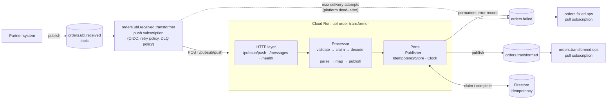
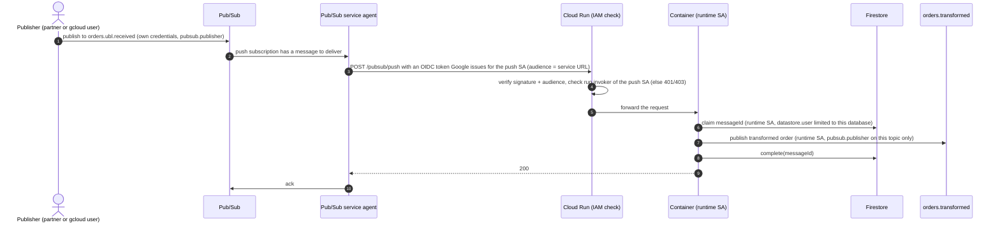

# Architecture

How the service is put together, how a message flows through it, and why Pub/Sub push needs special
care with HTTP status codes. Decisions and their alternatives are in [DECISIONS.md](DECISIONS.md).

## Components



The core is **hexagonal-lite**: the processor is plain TypeScript that depends on three ports. Adapters
plug in at startup (`src/server.ts`, the composition root):

| Port               | Production adapter                                                  | Local / test adapter                                                 |
| ------------------ | ------------------------------------------------------------------- | -------------------------------------------------------------------- |
| `Publisher`        | `PubSubPublisher` (`@google-cloud/pubsub`, ADC)                     | `InMemoryBroker` (topics, push delivery, redelivery, dead-lettering) |
| `IdempotencyStore` | `FirestoreIdempotencyStore` (transactions, shared by all instances) | `InMemoryIdempotencyStore` (per process)                             |
| `Clock`            | system clock                                                        | fixed clock in tests                                                 |

Only I/O, state and time are behind ports. Pure libraries (the XML parser, Zod) are used directly.

## Source layout

```
src/
  domain/     pure functions: message validation (Zod), strict Base64, hardened XML parsing,
              UBL -> JSON mapping, error types
  pipeline/   processor (orchestration, outcomes, DLQ records, logging), retry with backoff + jitter
  ports/      Publisher, IdempotencyStore, Clock interfaces
  adapters/   Pub/Sub, Firestore and in-memory implementations
  http/       Express routes, push envelope unwrapping, outcome -> HTTP status, error handler
  observability/  pino logger with Cloud Logging severity
  local/      helpers for samples and the in-process simulation
  app.ts      createApp(deps): builds the Express app, no side effects
  server.ts   composition root: config, adapters, listen, graceful shutdown
```

## Message shapes

The spec's "Pub/Sub message" is the JSON carried in the Pub/Sub message **data**:

```json
{
  "messageId": "7a1e78c9",
  "timestamp": "2026-07-27T12:00:00Z",
  "document": "<Base64 of the UBL XML>"
}
```

On a push subscription Pub/Sub wraps it in an envelope, so the order XML is Base64-encoded **twice**:

```text
push envelope { message: { data: Base64(app message JSON), messageId, attributes }, subscription, deliveryAttempt }
   └─ data ──Base64──> app message { messageId, timestamp, document }
                          └─ document ──Base64──> UBL 2.1 Order XML
```

`POST /messages` accepts the app message directly. `samples/push-envelope.valid.json` shows a full
envelope.

## Processing pipeline

1. **Validate** the app message (Zod): message, `messageId` and a non-empty `document` must exist.
2. **Claim** the `messageId` in the idempotency store. A completed key returns the stored output
   (`duplicate`); a key being processed returns `in-progress`.
3. **Decode** Base64 strictly (alphabet, length, canonical round-trip), then UTF-8.
4. **Parse** the XML: reject any `DOCTYPE` (XXE, billion laughs), require one root, ignore namespace
   prefixes, keep every value as a string, force arrays for `OrderLine` and `Note`.
5. **Map** UBL to the output JSON, collecting every validation issue; the result is checked against a
   Zod schema of the output.
6. **Publish** to `orders.transformed` (attributes `messageId`, `orderId`), retrying transient
   failures with exponential backoff and full jitter, then **complete** the claim.

Any failure releases the claim, so a redelivery or a corrected resend can be processed. Each message
produces one summary log line with `messageId`, `outcome` and `durationMs`.

## Outcomes and HTTP status codes

Pub/Sub push treats only 102, 200, 201, 202 and 204 as an **ack**. Anything else, including 400, is a
**nack**: the message is redelivered with backoff until the dead-letter policy moves it. A 400 for a
broken order would therefore turn it into a _poison message_, processed again and again for nothing.

So the two endpoints map the same processor outcomes differently:

| Outcome                                                            | `POST /pubsub/push`                                        | `POST /messages`        |
| ------------------------------------------------------------------ | ---------------------------------------------------------- | ----------------------- |
| `published`                                                        | 200 (ack)                                                  | 200 + transformed order |
| `duplicate`                                                        | 200 (ack, nothing published)                               | 200 + stored output     |
| `rejected` (permanent: InvalidBase64, InvalidXml, ValidationError) | **200** (ack) after the error record is on `orders.failed` | 400 + error body        |
| `rejected`, but the DLQ publish failed                             | 500 (nack: nothing is lost)                                | 400 + error body        |
| `failed` (transient, after in-app retries)                         | 500 (nack: Pub/Sub redelivers)                             | 500 ServerError         |
| `in-progress` (same `messageId` being processed)                   | 409 (nack: retried later)                                  | 409 DuplicateInProgress |

**Invariant (push path):** every message that enters the pipeline ends in exactly one of
`orders.transformed` or `orders.failed`, either by the app (permanent errors, with
`failureSource=app`) or by the platform's dead-letter policy (transient errors after
`max_delivery_attempts`, original message with `CloudPubSubDeadLetterSource*` attributes).

## Retries: two layers

1. **In the service:** publishing is retried up to `PUBLISH_MAX_ATTEMPTS` times with exponential
   backoff and full jitter. Permanent errors are never retried. The client library's own retries are
   disabled and each publish has a timeout, so the whole budget stays below the 60 s ack deadline.
2. **On the platform:** a nacked message is redelivered with the subscription's retry policy (10 s to
   600 s). After `max_delivery_attempts` (Terraform variable, default 5) Pub/Sub dead-letters it.

## Identities, hop by hop

No service-account keys anywhere: every hop uses a Google-issued token.



| Hop                                 | Identity                                                            | Permission                                                                                  |
| ----------------------------------- | ------------------------------------------------------------------- | ------------------------------------------------------------------------------------------- |
| Publish to the input topic          | the publisher's own account                                         | `pubsub.publisher` on `orders.ubl.received`                                                 |
| Push to Cloud Run                   | Pub/Sub service agent, presenting an OIDC token for the **push SA** | push SA: `run.invoker` on this service                                                      |
| Token check                         | Cloud Run infrastructure (no JWT code in the app)                   | enforces `run.invoker`                                                                      |
| Firestore, publish, app DLQ records | **runtime SA**, tokens from the metadata server (ADC)               | `datastore.user` (IAM condition: one database); `pubsub.publisher` on the two output topics |
| Platform dead-lettering             | **Pub/Sub service agent** under its own identity                    | `pubsub.publisher` on `orders.failed`, `pubsub.subscriber` on the push subscription         |

## Idempotency across instances

The idempotency key is the application `messageId`: a partner resend gets a new Pub/Sub message id
but keeps its own id, and `orderId` would be business-level dedupe (a corrected order may be resent).

Cloud Run routes requests by load, not by key, so an in-memory store only catches a duplicate that
happens to reach the same instance. The deployed service uses `FirestoreIdempotencyStore`:

- every operation is a **Firestore transaction**, so the claim is atomic across instances;
- claims expire after 60 s, so a crashed instance cannot block a key;
- a **fencing token** makes `complete`/`release` no-ops for a stale holder whose claim was taken over;
- the document id is `sha256(messageId)` (partner ids may contain `/`);
- the stored output is a JSON string, so duplicates get it back byte for byte;
- a TTL policy on `expiresAt` cleans up old documents.

Output remains **at-least-once**: if an instance dies after publishing but before `complete()`, the
redelivery publishes again. Consumers dedupe on the `messageId` attribute (inbox pattern), or the
service would need a transactional outbox.
